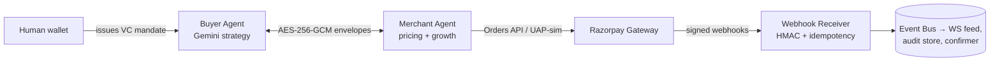

# AgentPay — Cryptographically Verifiable Agent-to-Agent Checkout

> Two sovereign AI agents negotiate and settle autonomously — bounded by signed spending mandates, encrypted end-to-end, with an audit trail a third party can verify without trusting either agent.
>
> **Payment honesty:** Razorpay **test-mode Orders API** when configured (`RAZORPAY_MOCK_MODE=false`); UAP/UPI Reserve Pay autonomous capture is **simulated** until those NPCI rails are available. Mock and live test-mode share the same confirmation pipeline (ADR-014).

---

## The Problem

AI agents can't pay each other. Traditional checkout demands human OAuth at every step, and nobody trusts two bots with money: what stops a prompt-injected buyer from overspending? What proves a merchant agent didn't fabricate a receipt? NPCI's UAP and the global protocol race (ACP, AP2, x402) exist because this is *the* open problem of agentic commerce.

## The Solution

AgentPay is a full checkout protocol where **LLMs are the commercial brain but never touch the money rails**. The architecture is a strict separation across three pillars:

```
"Buy GPU hours under ₹4,500"
        │
        ▼  PROMPT LAYER
┌─────────────────────┐
│ Gemini / OpenRouter  │   decides intent, evaluates quotes, extracts goals
│ + deterministic      │   from natural language — commercial judgement only
│   fallback policy    │
└──────────┬──────────┘
           │  model output crosses the output classifier boundary
           ▼  CONTEXT LAYER
┌─────────────────────┐
│ Verifiable Credential│   signed spending mandate bounds the decision space:
│ spending mandate     │   maxAmount · category allowlist · merchant whitelist ·
│ + SpendLedger        │   rolling 24h cumulative limit — cryptographically enforced
└──────────┬──────────┘
           │  only mandate-compliant decisions reach the harness
           ▼  HARNESS LAYER
┌─────────────────────┐
│ Zod output classifier│   → semantic clamps (discount [5 %–15 %])
│ → checkMandateBounds │   → Ed25519-signed transaction
│ → FSM agentic loop   │   → Razorpay Orders API + UAP-simulated capture
│ → webhook confirmer  │   → SHA-256 hash-linked audit receipt
└─────────────────────┘
```

**The invariant:** *the AI proposes, the protocol disposes.* Every money action passes four deterministic gates no model output can bypass.

## 30-Second Demo

```bash
npm install && npm run dev          # → http://localhost:3000
# Click "Execute Autonomous Checkout" — watch the live WS protocol stream,
# then try the chat: "Buy GPU hours for a fine-tune run under ₹4500"
```

Optional keys in `.env`: `GEMINI_API_KEY` (+ `OPENROUTER_API_KEY` failover) enable LLM strategies; everything works offline on deterministic fallback policies.

## Three-Pillar Architecture

AgentPay applies the **Prompt × Context × Harness** separation as its core design principle. Each pillar has a hard interface — no layer can reach across the boundary into another's authority.

### Prompt — commercial strategy, nothing more

The LLM layer (Gemini 1.5 Flash with OpenRouter failover) makes two decisions per checkout: *what to buy* and *whether the quote is fair*. It sees catalog JSON and budget numbers. It does not see signing keys, mandate stores, or gateway handles.

Every model output crosses a **Zod output classifier** (`src/ai/firewall.ts`) before entering protocol code:

- Three-attempt repair loop with structured error feedback to the model
- Exhaustion throws `LLMFirewallError` → deterministic fallback strategy takes over
- Malformed, hallucinated, or prompt-injected outputs never reach the wire

This is the output-classifier pattern from fintech guardrails — not a best-effort hope, but a typed gate the protocol enforces.

### Context — the machine-readable mandate

The buyer's spending authority is a **W3C Verifiable Credential** issued by their sovereign wallet and signed with Ed25519. It encodes:

- `maxAmount` — hard per-transaction cap in paise
- `allowedCategories` — category allowlist (e.g. `["cloud_services", "compute_gpu"]`)
- `merchantWhitelist` — DID allowlist or `["*"]`
- `dailyLimit` — rolling 24-hour cumulative cap, enforced by `SpendLedger`
- `currency` — denomination lock (INR mandate cannot settle USD)

The VC is presented over an encrypted channel, verified by the merchant, and its hash is chained into the final audit receipt. The mandate is the knowledge base that bounds every decision the prompt layer can make.

### Harness — deterministic money core

Four sequential gates that no strategy verdict can bypass:

| Gate | Implementation | What it blocks |
|---|---|---|
| Output classifier | `validateWithRetry` (Zod, 3 attempts) | Malformed / hallucinated LLM JSON |
| Semantic clamps | Post-model discount clamp [5 %–15 %] | LLM-invented margin outside protocol bounds |
| Mandate bounds | `checkMandateBounds` before signing | Any spend violating the VC — prompt injection ceiling |
| FSM agentic loop | `ProtocolStateMachine` — throws `ProtocolViolationError` on illegal jumps | Out-of-order messages, state skip attacks |

The FSM drives the **agentic loop**: `INIT → DID_EXCHANGED → SESSION_ESTABLISHED → MANDATE_VERIFIED → CATALOG_RECEIVED → INTENT_SENT → QUOTE_RECEIVED → SIGNED → SETTLED`. Every transition is hash-stamped and observable.

## Fintech Guardrails (load-bearing, not advisory)

These are not nice-to-haves. They are structurally load-bearing — the system cannot settle a payment if any of them is absent or bypassed.

| Redline | Enforcement |
|---|---|
| **Prompt injection can't overspend** | `checkMandateBounds` runs *before* Ed25519 signing, outside LLM reach. A HARD OVERRIDE flips any strategy "accept" to "reject" with an auditable rationale when bounds are violated. |
| **No PII or keys in the prompt context** | LLM strategies receive only catalog JSON and numeric budget. Mandate data, signing keys, and UPI IDs are handled exclusively in the harness layer. |
| **LLM can't hallucinate discounts** | Post-model semantic clamp enforced at the protocol boundary. The trace records both `discountRequested` and `discountApplied` so the gap is visible in every audit. |
| **No double-charging** | Nonce idempotency guard checked before any gateway call. Duplicate nonces return the cached receipt; the gateway is never called twice for the same transaction. |
| **Webhook spoofing blocked** | HMAC-SHA256 signature verification on every inbound Razorpay webhook. Tampered payloads return `401`; duplicates are ack'd once and discarded. |
| **Receipts are third-party verifiable** | SHA-256 audit digest chains `vcHash ‖ jwsHash ‖ orderId ‖ paymentId ‖ nonce`. A verifier who trusts neither agent can independently confirm the receipt. |

## Multi-Agent Orchestration

AgentPay implements a **two-agent orchestration pattern** — buyer and merchant run as independent sovereign agents with no shared state outside the encrypted protocol channel:

- Each agent holds its own Ed25519 signing key and X25519 key-agreement key
- Session keys are derived via ephemeral ECDH (X25519 → HKDF-SHA256) — compromise of one agent's long-term key cannot decrypt past sessions
- The protocol is message-passing with typed schemas; neither agent can reach into the other's internals
- A merchant growth subagent runs inside the merchant session: it generates cross-sell recommendations that are included *inside the signed quote payload* — the LLM cannot invent margin on recommendations either

This maps to the multi-agent orchestration pattern: bounded message contracts, typed outputs, deterministic arbitration when agents disagree.

## Architecture

See [docs/ARCHITECTURE.md](docs/ARCHITECTURE.md) for component/sequence diagrams and trust boundaries.



## Feature Inventory

| Layer | Capability |
|---|---|
| **Prompt** | Gemini 1.5 Flash + OpenRouter failover; goal extractor; deterministic fallback strategies when LLM unavailable |
| **Context** | W3C `did:key` self-certifying DIDs; Ed25519-signed VC spending mandates; rolling `SpendLedger` for daily cumulative limits |
| **Harness** | Zod output classifier with repair loop; semantic clamps; `checkMandateBounds`; linear FSM with `ProtocolViolationError`; nonce idempotency; HMAC webhook verification |
| **Transport** | Fresh ECDH handshake per round; AES-256-GCM with AAD binding; anti-replay sequence windows; cross-session rejection |
| **Integrity** | Detached Ed25519 JWS on transactions; merchant-signed quotes with recommendations inside the signature |
| **Payments** | Razorpay test-mode Orders API (live); UAP-simulated autonomous capture; unified `PaymentEventBus` for mock and webhook paths |
| **Resilience** | Two-phase reconciliation: signed challenges → receipt replay or signed void certificates (atomicity across network drops) |
| **Growth** | Merchant recommendation agent; buyer affordability gate; measured uplift analytics (`/api/merchant/analytics`) |
| **Observability** | Live WebSocket protocol feed; FSM visualizer; cryptographic proof inspector; per-decision "Why?" reasoning cards |

## Validation

```
15 test files · 93 tests passing · 1 skipped · 613ms
```

Test coverage spans: output classifier tamper/replay, cross-session rejection, LLM discount clamping, HARD OVERRIDE, nonce idempotency, daily cumulative limits, webhook HMAC forgery, growth attribution, atomicity recovery (settled and voided paths), LLM failover, and SQLite durable ledger.

```bash
npm test                  # full suite
npm run chaos             # 10,000 adversarial cases across 7 attack classes — expect 100% blocked
```

## Money-Action Guarantees

Every action that moves money is explainable, bounded and gated, leaves an audit trail, and fails safely.

| Criterion | Implementation |
|---|---|
| **Explainable** | Every decision carries a `reasoning{}` block with `rationale`, `source` (llm/deterministic), `attempts`, and clamp annotations. Surfaced as "Why?" cards in the dashboard and in every `/api/demo/run` response. |
| **Bounded** | VC mandates cap amount / category / merchant / daily-cumulative. Discount band clamped post-LLM. Recommendations pass a deterministic affordability gate. HARD OVERRIDE auditably rejects any strategy verdict that violates bounds. |
| **Gated** | Four sequential harness gates (classifier → clamps → `checkMandateBounds` → FSM). All deterministic. No gate is reachable from the prompt layer. |
| **Audit trail** | Hash-linked FSM transition history + proof bundle (VC hash, JWS, Razorpay order notes, gateway HMAC) rendered in the Proof Inspector. Durable SQLite backing. |
| **Graceful failure** | Network drop after signing triggers `RECONCILIATION_CHALLENGE` → replayed settlement receipt **or** cryptographically signed void certificate. Tested in `tests/atomicity.test.ts`; chaos-fuzzer covers 10,000 adversarial cases. |

## Related Protocols

| AgentPay concept | Aligns with |
|---|---|
| Spending-mandate VC issued by human wallet | AP2 verifiable mandates |
| Output classifier + semantic clamps | Fintech guardrail pattern (prompt injection defence) |
| Intent → signed quote → signed transaction | x402 / ACP payment-exchange pattern |
| Ephemeral ECDH sessions | Perfect forward secrecy standard |
| UPI Reserve Pay settlement | NPCI UAP circle delegation |

## Repository Map

```
src/
├── ai/            # Prompt layer: Zod output classifier, Gemini+OpenRouter failover, goal extractor
│   └── strategies/    # Buyer and merchant strategy implementations (LLM + deterministic)
├── agents/        # Multi-agent orchestration: BuyerAgent, MerchantAgent, session handlers
├── crypto/        # Ed25519/X25519 keys, detached JWS, AES-256-GCM, HMAC
├── identity/      # DIDs, Verifiable Credentials, SpendLedger, checkMandateBounds
├── payment/       # Razorpay gateway, mandate-gateway, PaymentEventBus
├── protocol/      # Zod wire schemas, FSM agentic loop, negotiation primitives
├── server/        # Fastify routes, chat orchestrator, WS feed, webhooks
└── session/       # ECDH handshake, SecureChannel envelopes
tests/             # 93 tests: classifier, tamper/replay, idempotency, failover, growth, atomicity
scripts/chaos-fuzzer.ts   # 10,000 adversarial attacks across 7 classes
docs/
├── ARCHITECTURE.md    # Component + sequence diagrams, trust boundaries
├── PROTOCOL.md        # Wire format spec, all 9 message schemas
├── SECURITY.md        # Threat model, 8 attack vectors + mitigations
└── adr/               # 14 Architecture Decision Records
```

## Roadmap

- Live autonomous capture when NPCI UAP mandate rails open to test participants
- Multi-merchant parallel negotiation (buyer picks best signed quote)
- MCP server wrapper — expose `agentpay_checkout` as a tool so any Claude Code session can transact via AgentPay
- Hash-chained persistent ledger + public receipt-verifier page

---

MIT licensed.
