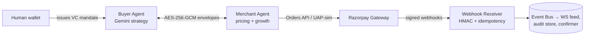

# AgentPay — Cryptographically Verifiable Agent-to-Agent Checkout

> Two sovereign AI agents negotiate and settle autonomously — bounded by signed spending mandates, encrypted end-to-end, with an audit trail a third party can verify without trusting either agent.
>
> **Payment honesty:** Razorpay **test-mode Orders API** when configured (`RAZORPAY_MOCK_MODE=false`); UAP/UPI Reserve Pay autonomous capture is **simulated** until those NPCI rails are available. Mock and live test-mode share the same confirmation pipeline (ADR-014).

---

## The Problem

AI agents can't pay each other. Traditional checkout demands human OAuth at every step, and nobody trusts two bots with money: what stops a prompt-injected buyer from overspending? What proves a merchant agent didn't fabricate a receipt? NPCI's UAP and the global protocol race (ACP, AP2, x402) exist because this is *the* open problem of agentic commerce.

## The Solution

AgentPay is a full checkout protocol where **LLMs are the commercial brain but never touch the money rails**:

```
"Buy GPU hours under ₹4,500"
        │
        ▼
┌─────────────────────┐     ┌──────────────────────────┐
│ Gemini/OpenRouter    │     │ Deterministic Protocol   │
│ strategy layer       │────▶│ Zod firewall → clamps →  │
│ (what to buy, price) │     │ mandate bounds → FSM     │
└─────────────────────┘     └────────────┬─────────────┘
                              did:key identity + ECDH + AES-256-GCM
                                        │
                             Ed25519-signed transaction
                                        │
                              Razorpay UPI Reserve Pay
                                        │
                        Settlement receipt + audit digest + webhook confirmation
```

**The invariant:** *the AI proposes, the protocol disposes.* Every money action passes four deterministic gates no model output can bypass.

## 30-Second Demo

```bash
npm install && npm run dev          # → http://localhost:3000
# Click "Execute Autonomous Checkout" — watch the live WS protocol stream,
# then try the chat: "Buy GPU hours for a fine-tune run under ₹4500"
```

Optional keys in `.env`: `GEMINI_API_KEY` (+ `OPENROUTER_API_KEY` failover) enable LLM strategies; everything works offline on deterministic policies.

## Feature Inventory

| Layer | Capability |
|---|---|
| Identity | W3C `did:key` self-certifying DIDs (Ed25519 signing + X25519 key-agreement) |
| Authorization | Verifiable-Credential **spending mandates**: per-txn max, category allowlist, merchant whitelist, **cumulative daily limit** (rolling 24h `SpendLedger`) |
| Transport | Fresh ECDH handshake per checkout round; AES-256-GCM envelopes with AAD binding, anti-replay sequence windows, cross-session rejection |
| Negotiation | Encrypted catalog/intent/quote exchange; LLM or deterministic strategies; discount hard-clamped to [5%, 15%] |
| Integrity | Detached Ed25519 JWS on transactions; merchant-signed quotes **including recommendations inside the signature** |
| Payments | Razorpay test-mode Orders API (live) / UAP-simulated capture; unified webhook pipeline (`payment.captured` HMAC-verified, idempotent) |
| Resilience | Two-phase reconciliation: signed challenges → receipt replay or signed void certificates (atomicity across network drops) |
| Growth | Merchant recommendation agent (cross-sell inside signed quotes); buyer affordability gate; measured uplift analytics |
| Observability | Live WebSocket protocol feed, FSM visualizer, cryptographic proof inspector, per-decision "Why?" reasoning cards |

## Architecture

See [docs/ARCHITECTURE.md](docs/ARCHITECTURE.md) for component/sequence diagrams and trust boundaries.



## Security Model

Full analysis: [docs/SECURITY.md](docs/SECURITY.md). Design decisions: [docs/adr/](docs/adr/) (14 ADRs).

| Guarantee | Mechanism |
|---|---|
| Prompt injection can't overspend | VC mandates enforced by `checkMandateBounds` **before signing** — outside the LLM's reach entirely |
| LLM can't hallucinate discounts | Post-model clamp [5%, 15%] at the protocol boundary; trace records requested vs applied |
| Malformed LLM output can't enter the protocol | Zod firewall with error-feedback repair loop; exhaustion → deterministic fallback |
| Tampered/replayed frames rejected | AES-256-GCM auth tags + monotonic sequence windows + session-ID binding |
| Double-charging impossible | Nonce idempotency guard before any gateway call |
| Receipts are verifiable | SHA-256 audit digest chaining VC hash ‖ JWS hash ‖ orderId ‖ paymentId ‖ nonce |

## Money-Action Guarantees

Every action that moves money is explainable, bounded and gated, leaves an audit trail, and fails safely.

- **Explainable** — every decision carries a cached rationale surfaced as "Why?" cards; `/api/demo/run` returns the full `reasoning{}` block (intent decision, quote evaluation, pricing trace with clamp annotations).
- **Bounded** — mandate VCs cap amount/category/merchant/daily-cumulative; discount band clamped post-LLM; recommendations pass a deterministic affordability gate before acceptance.
- **Gated** — four sequential gates: Zod firewall → semantic clamps → `checkMandateBounds` → linear FSM that throws `ProtocolViolationError` on any illegal jump.
- **Audit trail** — hash-linked transition history + proof bundle (VC, JWS, order notes, gateway HMAC) rendered in the Proof Inspector.
- **Graceful failure** — network drop after signing triggers `RECONCILIATION_CHALLENGE` → replayed settlement receipt **or** cryptographically signed void certificate (`tests/atomicity.test.ts`, chaos-fuzzer: 10,000 adversarial cases blocked).

## Related Protocols

| AgentPay concept | Aligned with |
|---|---|
| Spending-mandate VC issued by human wallet | AP2 verifiable mandates |
| Intent → signed quote → signed txn | x402 / ACP payment-exchange pattern |
| UPI Reserve Pay settlement | NPCI UAP circle delegation |

## Repository Map

```
src/
├── ai/            # Strategy layer: firewall, Gemini+OpenRouter failover, goal extraction
├── agents/        # Buyer/Merchant agents, session handlers, catalog
├── crypto/        # Ed25519/X25519 keys, JWS, AES-GCM, HMAC
├── identity/      # DIDs, Verifiable Credentials, SpendLedger
├── payment/       # Razorpay gateway, mandate-gateway, webhook event bus
├── protocol/      # Zod wire schemas, FSM, negotiation primitives
├── server/        # Fastify routes, chat orchestrator, WS feed, webhooks
└── session/       # Handshake, SecureChannel envelopes
tests/             # 73 tests incl. tamper/replay/idempotency/failover/growth
scripts/chaos-fuzzer.ts   # 10k adversarial attacks across 7 classes
docs/adr/          # 14 architecture decision records
```

## Roadmap

- Live autonomous capture when NPCI UAP mandate rails open to test participants
- Multi-merchant parallel negotiation (buyer picks best signed quote)
- Hash-chained persistent ledger (SQLite) + public receipt-verifier page
- MCP server wrapper so desktop assistants can transact via AgentPay

---

MIT licensed.
