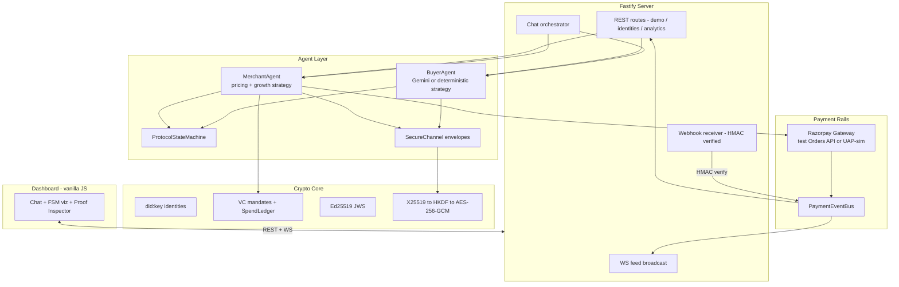
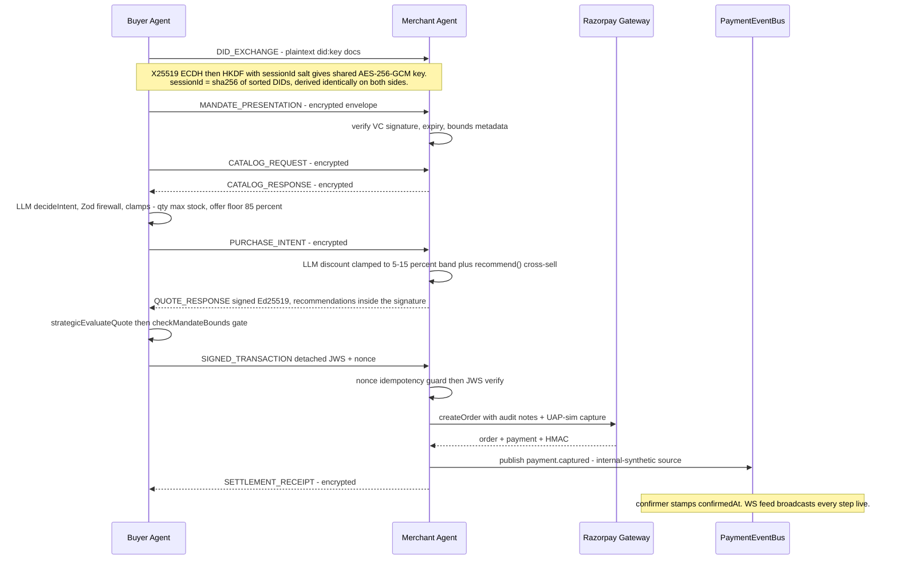
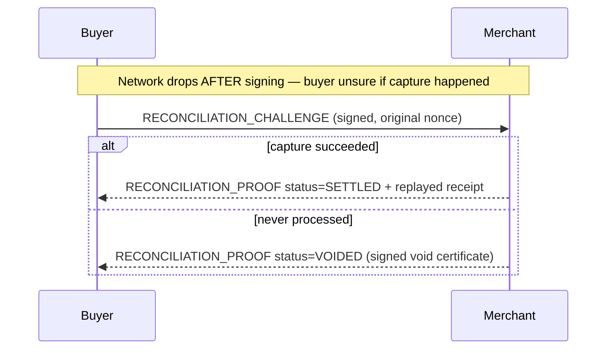

# AgentPay Architecture

> **Read time:** 60 seconds for the skim, ~10 minutes for the full document.

## 60-Second Skim

**What it is:** Two AI agents (buyer + merchant) negotiate and settle a purchase autonomously. The LLM only ever *proposes* — every money-moving decision is checked by deterministic, non-LLM code before it can take effect.

**The one-line flow:**

```
Buyer Agent  <-- encrypted, signed protocol -->  Merchant Agent  -->  Razorpay  -->  Webhook/Event Bus  -->  Live Dashboard
(LLM proposes)                                   (LLM proposes)      (real order)   (confirms settlement)
```

**The four deterministic gates every transaction must pass** (none reachable from the LLM):

1. **Zod firewall** — malformed/hallucinated LLM output is rejected and retried before it ever becomes a protocol message.
2. **Semantic clamps** — e.g. discount is hard-capped to [5%, 15%] regardless of what the LLM proposes.
3. **`checkMandateBounds`** — the signed spending-mandate Verifiable Credential caps amount, category, merchant, and cumulative daily spend. A strategy's "accept" can be overridden to a hard reject; it can never override a reject.
4. **Protocol FSM** — a strict linear state machine; any out-of-order or illegal transition throws immediately.

**Why you can trust the receipt:** every transaction is bound together by a SHA-256 audit digest chaining the mandate hash, the buyer's Ed25519 signature, the Razorpay order/payment IDs, and a replay-proof nonce — independently verifiable without trusting either agent.

**By the numbers:** 93 automated tests · 14 ADRs · 10,000-case adversarial chaos fuzzer · 4 sequential gates · 1 invariant ("the AI proposes, the protocol disposes").

**Jump to:** [Component Overview](#component-overview) · [Checkout Sequence](#checkout-sequence-happy-path) · [Failure Recovery](#failure-recovery-atomicity) · [Trust Boundaries](#trust-boundaries) · [Key Invariants](#key-invariants-enforced-by-tests)

---

## Full Architecture

The rest of this document is the detailed reference: component diagrams, the full message sequence, failure-recovery mechanics, trust-boundary reasoning, and the invariant-to-test mapping.

## Component Overview



## Checkout Sequence (happy path)



## Failure Recovery (atomicity)



## Trust Boundaries

1. **LLM sandbox** — strategies see only catalog JSON/budget numbers and return typed decisions. No keys, no gateway handles, no mandate store access. All outputs cross the **Zod firewall** (`validateWithRetry`, 3 attempts with error feedback) then **semantic clamps** before entering protocol code.
2. **Deterministic money core** — `checkMandateBounds` (amount/category/merchant/daily-cumulative via SpendLedger) is the ONLY signing authority. Strategy verdicts are advisory; a strategy "accept" cannot override a bounds rejection (HARD OVERRIDE flips it to reject with an auditable rationale).
3. **Transport** — every post-handshake frame is an encrypted envelope; loopback raw-object mode exists solely for in-process tests.
4. **Gateway** — orders may be real test-mode API calls; capture confirmation is unified through `PaymentEventBus` whether internal-synthetic or externally-HMAC-verified webhook. Idempotent at route AND domain layers.

## Key Invariants (enforced by tests)

| Invariant | Test |
|---|---|
| Both parties derive identical session keys | `secure-envelope.test.ts` |
| Every post-handshake frame encrypted; tamper/replay/cross-session rejected | `secure-envelope.test.ts` |
| LLM 47% discount → applied 15%, annotated in trace | `ai-strategy.test.ts` |
| Strategy "accept" on over-cap quote → HARD OVERRIDE reject | `ai-strategy.test.ts` |
| Duplicate nonce → idempotent receipt, no double charge | `phase0-hygiene.test.ts` |
| dailyLimit cumulative enforcement | `phase0-hygiene.test.ts` |
| Webhook tamper → 401; duplicates ack'd once | `webhook.test.ts` |
| Upsell revenue attributed incrementally | `growth.test.ts` |
